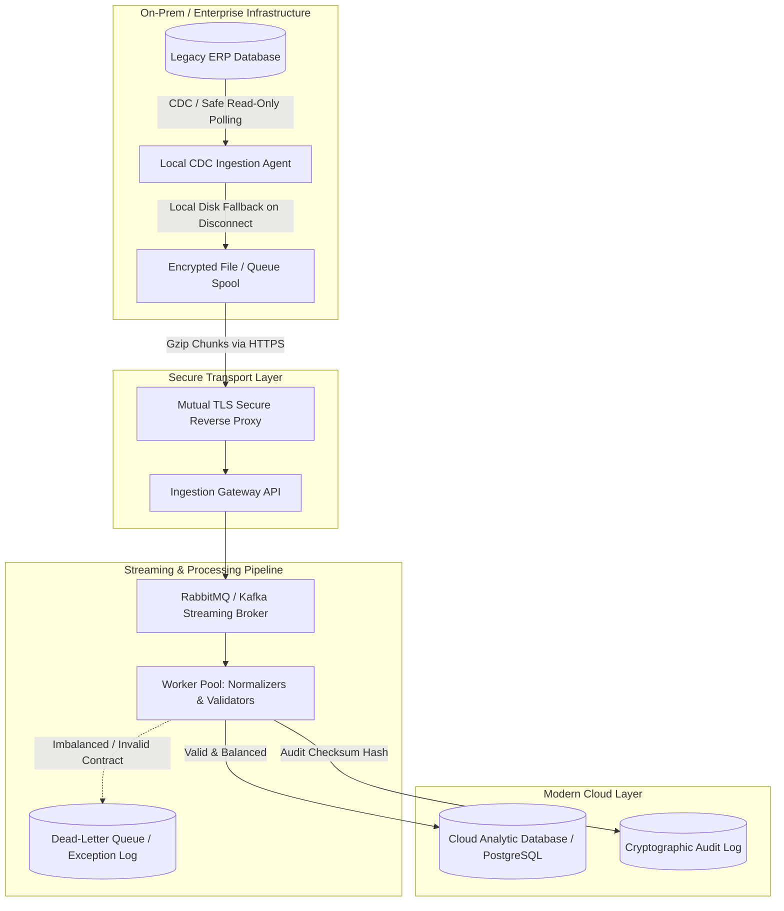

# Enterprise ERP Two-Way Sync Blueprint

A resilient, event-driven extraction and reconciliation architecture designed for syncing legacy enterprise ERP systems (e.g., Sage X3, SAP, Tally) with modern cloud databases, data warehouses, and analytics layers.

---

## The Challenge
Enterprise ERP systems are monolithic, frequently run on-premise behind strict corporate firewalls, and lack modern webhook infrastructure. Direct database querying risks database locks on active transactions, while naive scheduled batch jobs cause data drift, ledger imbalances, and undetected sync failures.

---

## Architectural Topology



---

## Key Reliability Patterns

- **Dual-Entry Integrity Check**: Validates debits against credits in integer cents before any entry is committed to the target database. Imbalanced entries route to an isolated Dead Letter Queue (DLQ).
- **Cryptographic Reconciliation**: Computes deterministic SHA-256 state signatures (`reconciliationFingerprint`) per voucher. Scheduled reconciliation sweeps verify ledger integrity across both source and target.
- **Offline Fault Tolerance**: The local ingestion agent utilizes a persistent local buffer. If connectivity drops between on-premise infrastructure and the cloud gateway, data is safely spooled without dropping records.
- **Contract Enforcement**: Strict schema validation ensures non-standard ERP nulls, malformed dates, and missing cost centers are sanitized prior to transformation.

---

## Repository Structure

```text
├── docker-compose.yml              # Message broker & target database topology
├── contracts/
│   └── erp_journal_entry.json      # Enterprise ERP extraction contract
├── src/
│   ├── extractors/                 # Read-only CDC extraction adapters
│   ├── transformers/
│   │   └── ledger_normalizer.ts    # Dual-entry validation & currency normalization
│   └── pipelines/                  # Broker consumer & retry management
└── README.md
```

---

## Running the Mock Stack

```bash
docker compose up -d
```